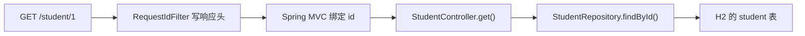

# 04 跟一条 HTTP 请求读完 CRUD

让 IDEA 按 [02 的调试配置](02-startup-and-profiles.md#在-intellij-idea-调试) 启动 `local`。下面用 `8082` 走一遍读取、新建、修改和删除。

## 先跟一次 GET

这条请求的主路径可以这样读。



打开 [StudentController](../../src/main/java/local/lesson/springdemo/StudentController.java)，在 `get()` 的 `return findStudent(id)` 处打第一个断点，再在 `findStudent()` 里调用 `students.findById(id)` 的位置打第二个断点。

```sh
curl -i http://127.0.0.1:8082/student/1
```

1. 查看第一个断点的 `id`，它应为 `1`。Spring MVC 找到 `@GetMapping("/student/{id}")`，把 URL 中的字符串 `1` 转成 `long`。路径值由 `@PathVariable` 绑定。对照 [Spring MVC 方法参数](https://docs.spring.io/spring-framework/reference/6.2/web/webmvc/mvc-controller/ann-methods/arguments.html)。
2. 继续执行到第二个断点。变量 `students` 是启动时注入的 [Repository](../../src/main/java/local/lesson/springdemo/StudentRepository.java)。这里查找主键，`findById()` 返回 `Optional<Student>`。
3. 恢复执行。记录存在时 Controller 返回 `Student`，Spring MVC 把它写成 JSON。初始库应看到 `{"id":1,"name":"Tom","phone":"1234567890","age":30}`。
4. 查看 `X-Request-ID` 响应头。在 [RequestIdFilter](../../src/main/java/local/lesson/springdemo/RequestIdFilter.java) 中，`local` profile 先为请求生成 UUID 并写入响应头，再执行后续过滤链。重复请求会得到不同的 ID。

多试两个输入。

```sh
curl -i http://127.0.0.1:8082/student/0
curl -i http://127.0.0.1:8082/student/abc
```

初始库没有 ID 为 0 的学生，应用会进入 `findStudent()` 并返回 `404`。第二个请求的 `abc` 无法绑定成 `long`，MVC 在进入该方法前就会返回 `400`。可以用断点确认失败分别发生在哪一层。

## 再跟一条写入

在 `create()` 的 `students.save(...)` 处打断点，执行下列请求。恢复执行后，记下响应中的新 `id`。

```sh
curl -i -X POST http://127.0.0.1:8082/student \
  -H 'Content-Type: application/json' \
  --data '{"name":"Amy","phone":"1234567890","age":20}'
```

断点里 `input` 的类型是 `StudentInput`。`@RequestBody` 将 JSON 反序列化到这个 record，Controller 从中取出三个字段，再构造 `Student`。保存后的响应为 `201`，响应体带数据库生成的 ID。

把刚才返回的 ID 输入终端。下面三次请求都使用这条新建记录。

```sh
printf '输入 POST 返回的新学生 ID：'
read -r student_id
curl -i -X PUT "http://127.0.0.1:8082/student/$student_id" \
  -H 'Content-Type: application/json' \
  --data '{"name":"Amy","phone":"1234567890","age":21}'
curl -i "http://127.0.0.1:8082/student/$student_id"
curl -i -X DELETE "http://127.0.0.1:8082/student/$student_id"
curl -i "http://127.0.0.1:8082/student/$student_id"
```

| 操作 | 应看到的结果 | 回到代码找原因 |
| --- | --- | --- |
| PUT | `200`，同一 ID 的年龄为 21 | `update()` 先查旧记录，调用实体的 `update(...)` 再保存 |
| GET | `200`，再次读到年龄 21 | 新请求从数据库读出刚保存的值 |
| DELETE | `204`，无响应体 | `delete()` 查出实体后删除，`@ResponseStatus` 设定状态 |
| 再 GET | `404` | 同一 ID 已不存在，走 `findStudent()` 的缺失分支 |

用 Postman 时，POST 和 PUT 在 Body 中选 raw → JSON，路径和请求体与上面相同。对照时同时看 HTTP 方法、状态码和 JSON，避免只看浏览器页面内容。

[上一篇：Flyway、实体与 Repository](03-data-and-migrations.md) · [返回目录](index.md) · [下一篇：readiness、OpenAPI 与认证](05-probes-and-security.md)
